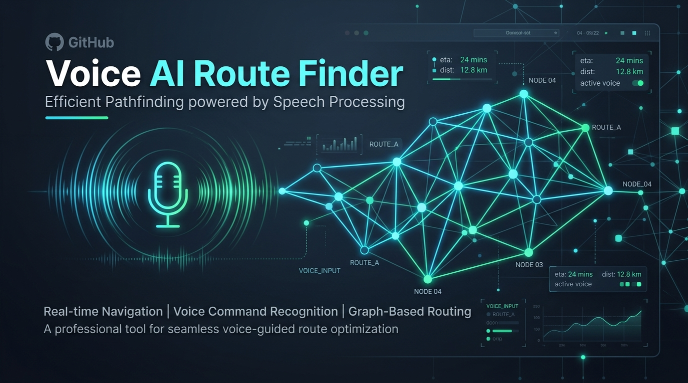
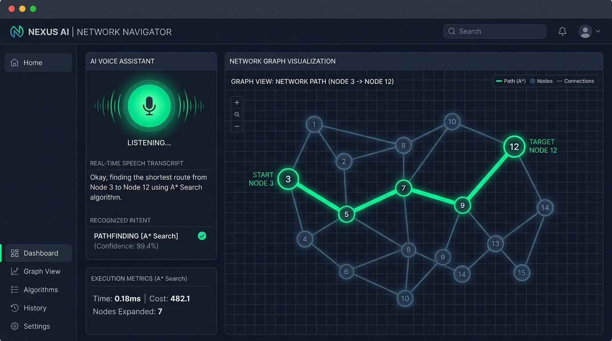
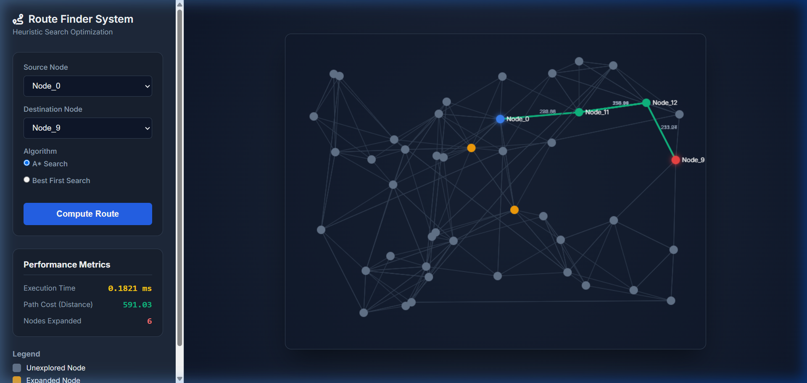

<div align="center">

# 🎙️ Voice AI Route Finder & Heuristic Navigator

**An intelligent multimodal AI system combining real-time Voice Command Processing with Graph-Based Heuristic Search Algorithms ($A^*$ & Greedy Best-First Search).**

[](https://www.python.org/)
[](https://flask.palletsprojects.com/)
[](https://pypi.org/project/SpeechRecognition/)
[](LICENSE)
[](https://developer.mozilla.org/en-US/docs/Web/API/Canvas_API)

<br/>



</div>

---

## 📌 Overview

**Voice AI Route Finder** addresses two foundational problems in modern software engineering:
1. **Multimodal Voice Interaction**: Hands-free voice recognition, client-side real-time audio encoding, and natural intent classification.
2. **Heuristic Pathfinding Optimization**: Real-time optimal route discovery across complex, weighted road networks with simulated dynamic traffic penalties.

The repository provides two specialized modules:
- 🎙️ **`voice_assistant/`**: Unified voice-driven dashboard where users speak natural routing instructions, trigger web searches, or launch applications.
- 🗺️ **`route_finder/`**: Dedicated algorithmic visualization and benchmarking sandbox comparing mathematical pathfinding efficiency.

---

## 📸 Screenshots & Demonstrations

### 1. AI Voice Assistant with Interactive Pathfinding
> Speak naturally: *"Find route from Node 3 to Node 12 using A\* Search"* to see speech recognition, intent extraction, and automated route drawing in real time.

<div align="center">
  
</div>

<br/>

### 2. Algorithmic Benchmarking Sandbox (`route_finder`)
> Step-by-step canvas rendering of node expansions, highway weights, and real-time execution metrics.

<div align="center">
  
</div>

---

## ✨ Key Features

- 🎙️ **Voice Command Recognition**: Integrated Google Speech Recognition API with custom client-side audio pipeline.
- 🎵 **In-Browser PCM WAV Transcoding**: Uses the Web Audio API to convert raw microphone audio blobs into 16kHz 16-bit Mono WAV files in-memory without server-side `ffmpeg` overhead.
- 🧠 **Dual Heuristic Pathfinding Engines**:
  - **$A^*$ Search (Optimal)**: Minimizes $f(n) = g(n) + h(n)$ using Euclidean distance heuristics. Mathematically guarantees the lowest travel cost.
  - **Greedy Best-First Search**: Rapidly expands nodes with minimal heuristic cost $f(n) = h(n)$, prioritizing traversal speed over overall optimality.
- 🚦 **Procedural Graph & Traffic Simulation**: Dynamically generates realistic road network topologies with variable traffic multipliers ($1.0\times$ to $2.5\times$) and express highways.
- 📊 **Real-Time Performance Metrics**:
  - **Execution Time (ms)**: Measured with microsecond precision (`time.perf_counter()`).
  - **Cumulative Path Cost**: Total distance adjusted for simulated traffic impedance.
  - **Nodes Expanded**: Visual indication of search space exploration and efficiency.
- 🌐 **Modern Dark-Mode UI**: Built with custom Vanilla CSS, glassmorphism accents, and responsive HTML5 Canvas animations.

---

## 🗂️ Project Structure

```text
voice-ai-route-finder/
├── docs/
│   └── images/
│       ├── banner.jpg                   # GitHub repository hero banner
│       ├── route_finder_demo.png        # Captured route finder UI screenshot
│       └── voice_assistant_demo.jpg     # Voice assistant interface preview
│
├── route_finder/                        # Dedicated Pathfinding Benchmarking Sandbox
│   ├── app.py                           # Flask REST API server (Port 8080)
│   ├── search_algorithms.py             # A* and Greedy Best-First search logic
│   ├── requirements.txt                 # Module dependencies
│   ├── templates/
│   │   └── index.html                   # Interactive graph UI
│   └── static/
│       ├── css/style.css                # Dark theme stylesheet
│       └── js/main.js                   # Canvas rendering & step animator
│
├── voice_assistant/                     # Multimodal Voice-Controlled System
│   ├── app.py                           # Flask backend with Speech NLP (Port 5000)
│   ├── search_algorithms.py             # Heuristic search implementations
│   ├── requirements.txt                 # Voice assistant dependencies
│   ├── templates/
│   │   └── index.html                   # Voice assistant dashboard
│   └── static/
│       ├── css/style.css                # Dashboard styling
│       └── js/script.js                 # Web Audio recorder, WAV converter & animator
│
├── .gitignore                           # Git ignore rules
└── README.md                            # Repository documentation
```

---

## 🧮 Algorithmic Comparison

| Metric | $A^*$ Search | Greedy Best-First Search |
| :--- | :--- | :--- |
| **Evaluation Function** | $f(n) = g(n) + h(n)$ | $f(n) = h(n)$ |
| **Optimality** | ✅ **Guaranteed optimal** | ❌ May produce suboptimal routes |
| **Completeness** | ✅ Complete | ✅ Complete (on finite graphs) |
| **Exploration Strategy** | Balances past cost + future estimate | Aggressively targets destination |
| **Best Used For** | GPS, delivery routing, network latency | Quick approximations, large exploration spaces |

---

## 🗣️ Supported Voice Commands

Click the microphone button and try commands such as:

| Intent | Example Voice Command | Action Taken |
| :--- | :--- | :--- |
| **Route Finding** | *"Find route from Node 3 to Node 12 using A Star Search"* | Computes optimal route and animates on canvas |
| **Route Finding (Greedy)** | *"Find path from Node 5 to Node 16 using Best First"* | Rapidly computes heuristic-first route |
| **Web Search** | *"Search for artificial intelligence algorithms"* | Opens a new tab with Google search results |
| **App Launcher** | *"Open YouTube"* / *"Open Google"* | Opens the target platform in a new browser tab |
| **Conversational** | *"Hello assistant"* / *"Hi"* | Displays assistant greeting response |

---

## 🚀 Quickstart Guide

### Prerequisites
- Python 3.8 or higher installed on your system.
- Modern web browser (Chrome, Edge, Firefox) with microphone permissions enabled.

### 1. Clone the Repository
```bash
git clone https://github.com/paras999000/voice-ai-route-finder.git
cd voice-ai-route-finder
```

### 2. Running the Voice Assistant (Recommended)
```bash
cd voice_assistant
pip install -r requirements.txt
python app.py
```
Open **`http://127.0.0.1:5000`** in your browser and allow microphone permissions.

### 3. Running the Route Finder Sandbox
```bash
cd route_finder
pip install -r requirements.txt
python app.py
```
Open **`http://127.0.0.1:8080`** in your browser.

---

## 🛠️ Tech Stack

- **Backend**: Python 3, Flask, Flask-CORS
- **Audio & NLP**: Google Speech Recognition API, `speech_recognition`, Web Audio API (PCM DataView)
- **Frontend**: Vanilla JavaScript (ES6+), HTML5 Canvas API, CSS3 (Modern Dark Theme)
- **Graph Algorithms**: Priority Queue (`heapq`), Euclidean Distance Metrics, Adjacency Graph Models

---

## 📄 License

This project is licensed under the [MIT License](LICENSE) - feel free to use, modify, and distribute for personal and educational projects.
